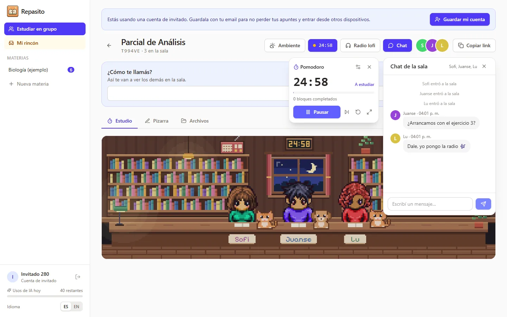
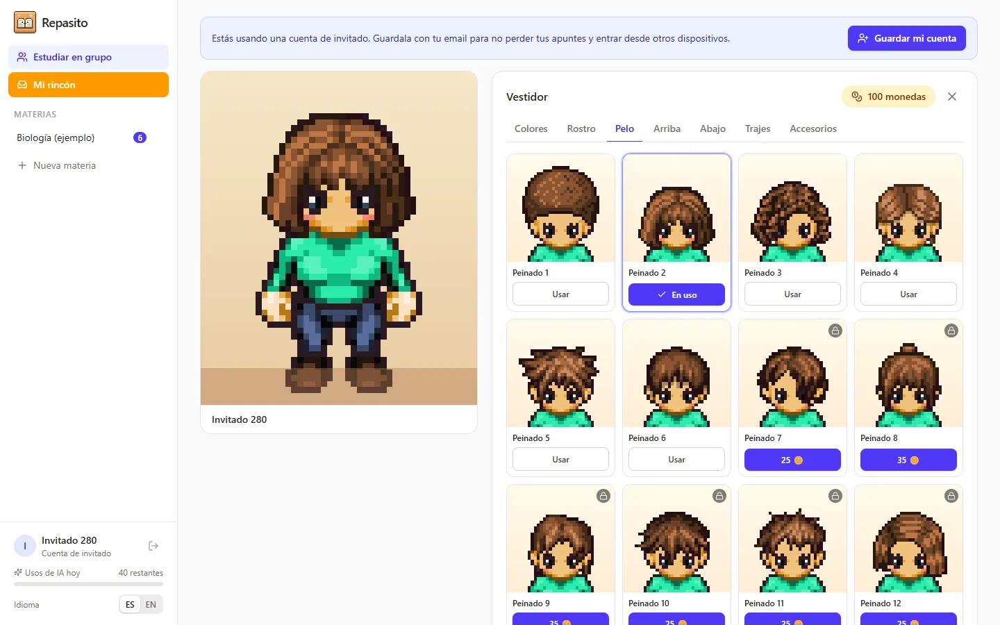
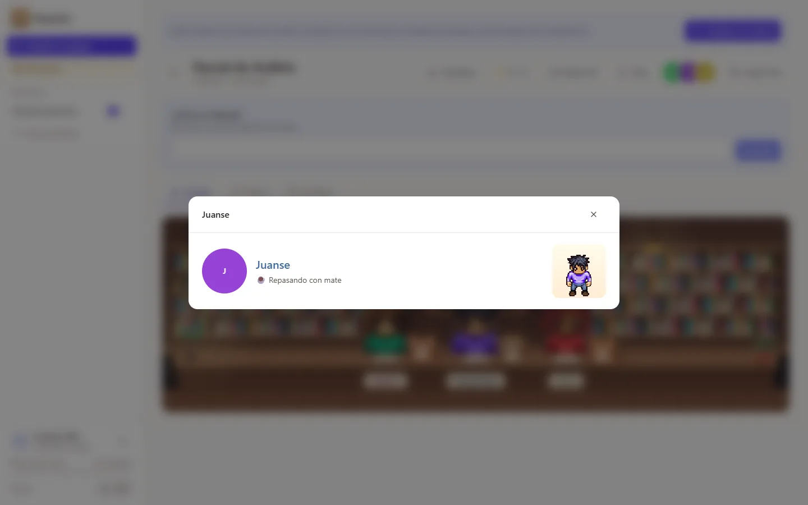
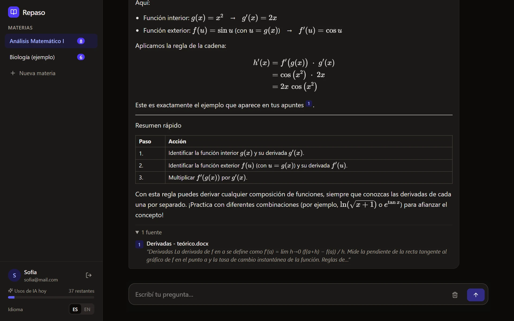
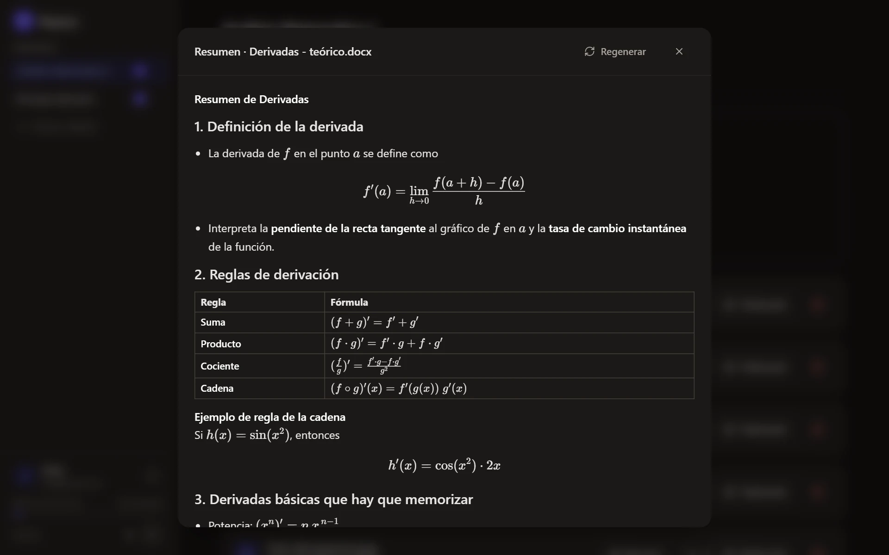
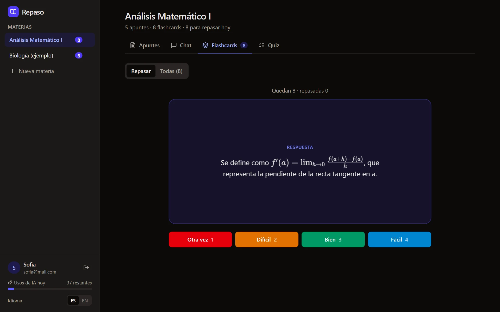
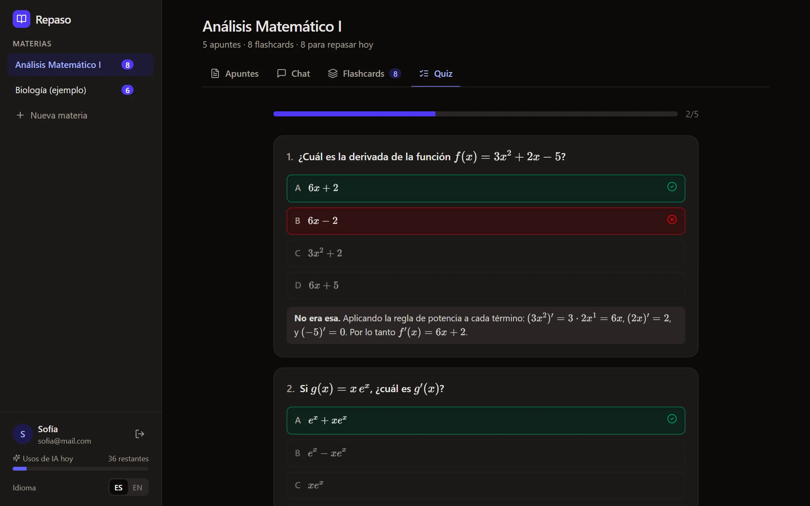

  

<h1 align="center">Repasito</h1>

  <b>Estudiar solo cuesta. Con amigos, se hace mucho más fácil.</b> 
  Repasito es una actividad de <b>Discord</b> para armar una sala de estudio con tu grupo, 
  y repasar tus materias con una <b>IA gratuita</b> integrada: resúmenes, flashcards, quizzes 
  y un chat para preguntarle lo que quieras sobre tus apuntes. En español o en inglés.

  

## 📚 Estudiar con amigos

¿Quedaron en estudiar juntos para el parcial y terminaron hablando de cualquier cosa? Abrí Repasito en el canal de Discord donde ya están y todos caen en la misma sala de estudio, sentados en la misma mesa, en pixel art. Cada uno ve a los demás estudiando, y eso solo ya ayuda a no colgarse.

- 🏆 **Trivia de la sala, tipo Preguntados:** alguien sube sus apuntes, la IA arma las preguntas y al resto le llega la invitación. Gana el que responde bien y más rápido, y todos se llevan monedas.
- 🎨 **Pizarra compartida** para resolver ejercicios, hacer esquemas y explicarse cosas entre todos, en vivo.
- 📎 **Archivos compartidos:** alguien sube el resumen o la guía de ejercicios y el resto la descarga al toque.
- 💬 **Chat** de la sala, para no mezclar el estudio con el resto del server.
- 🎧 **Música lofi:** una radio generada en vivo, sin copyright, con nueve estilos para elegir: noche tranquila, jazz de café, lluvia, atardecer, invierno, verano, bosque, espacial y solo piano.
- ⏱️ **Pomodoro propio** para cada uno, aunque estén en la misma sala, con un **modo concentración** a pantalla completa para cuando hay que meterle.
- 🏛️ **23 fondos para estudiar juntos:** biblioteca, cafetería, observatorio, laboratorio, taller de arte, consultorio, cine, una torre mística, un rincón kawaii y más.
- 🌧️ **Ambientaciones:** el clima de la ventana (noche, amanecer, día, atardecer, lluvia o nieve) y el ruido de fondo (lluvia, cafetería, chimenea, vinilo). Cada uno arma el ambiente que lo ayuda a concentrarse.
- 🧑‍🎨 **Tu personaje:** cuerpo, colores, ojos, unos 80 peinados, ropa, trajes, accesorios y una mascota entre 30 (de gatos y perros a una empanada o un mate con su termo).
- ☕ **Decoraciones** para tu lugar en la mesa (una taza, plantas, libros, un mate, un matcha, guirnaldas de luces) que también ven los demás.
- 🪙 **Monedas** que se ganan estudiando, subiendo apuntes y completando pomodoros, para gastarlas en ropa, mascotas y decoraciones.
- 🙋 **Perfil:** foto, apodo con color y una frase de qué estás estudiando o cómo te sentís. Tocando a alguien en la sala ves su miniperfil.

| Vestidor | Miniperfil |
|---|---|
|  |  |

## 🤖 Tus materias, con IA gratuita

Además de estudiar juntos, cada uno puede repasar sus materias con una IA integrada y gratuita. Tenés carpetas con tus materias, subís tus apuntes en casi cualquier formato, en español o en inglés, y te ayuda a **preparar el examen fijando los conceptos** con flashcards y quizzes. Y le podés consultar lo que quieras sobre tus apuntes:

- **Resúmenes** de cada apunte, ordenados por tema y con lo más importante al final.
- **Chat con tus apuntes:** responde usando solo lo que subiste y te dice de qué archivo y de qué página lo sacó. Escribe bien las fórmulas (LaTeX).
- **Quiz** de opción múltiple sobre toda la materia o un tema, con la explicación de cada respuesta.
- **Flashcards con repaso espaciado**, como Anki. Se pueden exportar a Anki o Quizlet.
- **Lee casi cualquier archivo:** PDF, Word, PowerPoint, Excel, OpenDocument, texto, y también fotos (de un libro, una fotocopia o el pizarrón) y PDFs escaneados.

La IA usa modelos open source en un plan gratuito: no hace falta pagar nada.

| Chat con los apuntes | Resumen |
|---|---|
|  |  |

| Flashcards | Quiz |
|---|---|
|  |  |

## 🚀 Cómo se usa

En un canal de voz o de texto de tu servidor de Discord, tocá el botón de **Actividades** (el cohete) y elegí **Repasito**. Entra con tu cuenta de Discord, sin registrarte.

Arriba a la derecha elegís el idioma (español o inglés) y el tema: claro, oscuro o automático. Funciona en la compu y en el celular, y es 100 % gratis.

## Límites

| | |
|---|---|
| Archivos por materia | hasta **50** |
| Tamaño por archivo | hasta **20 MB** |
| PDFs escaneados | hasta **15 páginas** que haya que leer como imagen |
| Usos de IA | **40 por día** por persona (preguntas, resúmenes, quizzes y tandas de flashcards) |

Subir archivos y repasar flashcards no gasta usos de IA. En las fotos, la letra impresa se lee mucho mejor que la escrita a mano.

## Cómo está hecha

- **Frontend:** React + TypeScript + Tailwind, con KaTeX para las fórmulas.
- **Backend:** FastAPI + SQLAlchemy (SQLite en local, Postgres en producción).
- **Discord:** Embedded App SDK. Fuera de Discord, la web solo explica cómo abrirla.
- **Salas en vivo:** WebSockets, con el estado de cada sala en el servidor (quién está, el chat y la trivia).
- **Música:** lofi generada en el navegador con Web Audio, sin archivos ni copyright.
- **Pizarra:** Excalidraw, sincronizada entre todos.
- **Pixel art:** el personaje se arma en el navegador apilando capas y tiñéndolas con los colores que elige cada uno; las salas y las mascotas están dibujadas con código.
- **IA:** modelos open source (gpt-oss y Qwen) en el plan gratis de [Groq](https://groq.com). Si un modelo se queda sin cupo, pasa al siguiente.
- **Búsqueda en los apuntes:** BM25 escrito a mano, para mandarle a la IA solo los fragmentos que importan.
- **Fotos y escaneos:** [Tesseract](https://github.com/tesseract-ocr/tesseract), que corre en el mismo servidor.
- **Repaso espaciado:** algoritmo SM-2.
